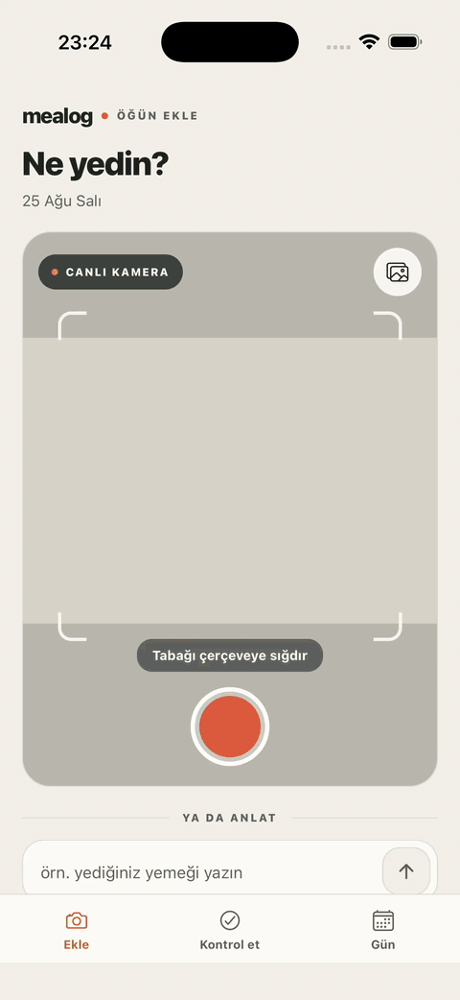
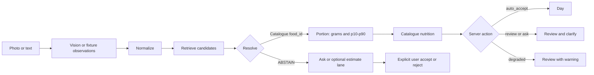

# Mealog — accuracy-first mobile meal logging

[](https://github.com/zexy2/mealog/actions/workflows/ci.yml)

Mealog is a React Native meal logger backed by a NestJS/TypeScript service. It
turns a photo or informal text into canonical foods, explicit portion ranges,
and catalogue-backed nutrition. When evidence is insufficient, it asks or
abstains instead of silently saving the nearest guess.

**Start here:** [Run in 30 seconds](#run-in-30-seconds) ·
[Architecture](#architecture) · [Decisions](docs/decisions.md) ·
[Evaluation](docs/evaluation.md)

<p align="center">
  
</p>

<p align="center"><sub>Live Gemini 3.1 Flash-Lite · iOS Simulator · one observed run · playback accelerated 1.7×. Integration evidence, not an accuracy benchmark.</sub></p>

## The problem it solves

Most meal loggers optimise for a complete-looking answer. Mealog optimises for
knowing when that answer is unsupported:

- **Closed-set identity:** grounded nutrition requires a catalogue `food_id`;
  otherwise resolution returns `ABSTAIN`.
- **Visible uncertainty:** portions are shown as grams plus p10–p90, with source
  and provenance—not as a hidden point estimate.
- **Human control:** server actions route a result to Day, Review, abstention,
  or retry. The mobile client does not infer acceptance locally.

The implementation uses a hybrid path: Gemini (or a deterministic fixture)
extracts observations; pure TypeScript stages normalize, retrieve, resolve,
estimate portions, compute grounded nutrition, and route the result. A separate
LLM estimate lane exists only after a catalogue miss. Its output is labelled
unverified, carries ranges and assumptions, is never auto-accepted, requires
explicit user acceptance, and is excluded from grounded evaluation.

## Run in 30 seconds

The fastest path is a keyless mobile demo: no Node service, network, or API key.

```sh
git clone https://github.com/zexy2/mealog.git
cd mealog/apps/mobile
npm ci
EXPO_PUBLIC_DEMO_MODE=true npm run ios
```

The Capture screen exposes six demo states: auto-accept, review, abstention,
degraded, provider error, and empty day. Start with **Review** to inspect the
p10–p90 band and “Nasıl bulundu?” audit, then use **Abstention** to see the
closed-set safety boundary. Use `npm run android` instead of `npm run ios` for
an available Android emulator/device.

Full local instructions, including the keyless Node API smoke test and the
optional live Gemini integration, are in [docs/running.md](docs/running.md).

## Architecture



| Boundary | Guarantee |
| --- | --- |
| Vision port | Produces observations, not canonical IDs or grounded nutrient values |
| Resolver | Returns a catalogue `food_id` or `ABSTAIN`; wrong perception and wrong in-catalogue matches remain possible |
| Portion | Preserves grams, p10–p90, source, and provenance |
| Grounded nutrition | Pure arithmetic over catalogue rows with source and licence status |
| Confidence gate | Routes on server action; mobile does not infer acceptance locally |
| Estimate lane | Separate endpoint; max 20 unresolved items, unverified label, explicit acceptance, excluded from grounded evaluation |

The HTTP API is NestJS/TypeScript. Python remains offline evaluation and
reference tooling, not the delivered backend.

## Design decisions

These are the choices that shaped the system, each with the trade-off it cost.
The full record is [decision log D1–D20](docs/decisions.md).

| Decision | What it buys | What it costs |
| --- | --- | --- |
| **The model never produces a nutrient number** ([D1](docs/decisions.md#d1)) | Unknown identity cannot silently receive authoritative nutrition | Low coverage; more questions to the user |
| **A locale is a data pack, not code** ([D2](docs/decisions.md#d2)) | New markets need no pipeline branches; licence stays explicit | Pack curation and legal review per market |
| **Worst-cuisine metric, read with coverage** ([D3](docs/decisions.md#d3)) | Distribution shift stays visible instead of hidden by an average | Small buckets are noisy and less flattering |
| **Expo mobile client, not a web app** ([D9](docs/decisions.md#d9)) | Real camera and native review flow | Device compatibility needs separate runtime verification |
| **NestJS edge plus Python evaluation harness** ([D12](docs/decisions.md#d12)) | Typed HTTP surface plus reproducible offline measurement | Two runtimes and parity ceremony |

## Evidence snapshot

Metrics below are from an offline replay of recorded, non-synthetic provider
responses. They are presented here because they are the honest state of the
project, not because they are flattering.

- **10/80 commit, 70/80 ask:** 12% grounded coverage in the V3 configuration.
- **Item F1 0.15; FP rate 86.0%:** the current identity layer is not accurate
  enough for broad automatic logging.
- **Calorie MAPE 12.7% on 2/2 rows:** too small a denominator for a general
  calorie-accuracy claim.

`ask` is a safe routing outcome, not a claim that every deferred candidate was
correct. The FP metric includes unsupported proposed items even when the system
defers them; it is not an 86% silent-commit rate. These are fixture-replay
results, not live-provider accuracy. The fixtures were recorded with
`gemini-flash-lite-latest`; they do not measure the live adapter default,
`gemini-3.6-flash`. Full cuisine slices, denominators, metric definitions, and
error taxonomy are in [docs/evaluation.md](docs/evaluation.md).

**Retrieval itself is strong where the catalogue covers the food:** 145 variants,
122/122 positive Recall@1, MRR 1.000, 0/22 absent-food false accepts. The
weak measured layer is perception and closed-set matching over photographed
food, which is why the gate abstains instead of guessing.

## Measured failures

| Failure | Current behaviour | Impact |
| --- | --- | --- |
| Occluded photographed counts | Two stacked simits become `quantity: null`, 100 g with a 65–145 g band, and a count question | Prevents silent undercount but adds review friction |
| Legume/soup near-neighbours | Some inputs still surface egg, bean, or soup neighbours; low confidence prevents silent commit | Proposed identity can still be wrong |
| Thin Turkish catalogue | 57 rows; common long-tail dishes are absent | More abstention and correction work |
| South Asian coverage | n=16, 0% coverage, Item F1 0.00 | Weakest market is unusable in this evaluation set |

Prepared pasta, bulgur, mantı, Turkish coffee, and tea probes abstain instead of
selecting raw/dry records. This contains a known error class; it does not solve
those foods. See [the error taxonomy](docs/evaluation.md#error-taxonomy).

## Reliability and observability

- Idempotency is scoped by `(user_id, idempotency_key)`; payload conflicts are
  rejected. Meal response cache is bounded to 5,000 entries and estimate cache
  to 500 entries.
- Provider failures use typed categories, retry metadata, degraded routing, and
  a client retry state.
- The edge propagates `X-Request-Id`, emits structured JSON events, records
  bounded process-local timings, and exposes `/health` plus `/metrics`.
- Metrics, rate-limit, and idempotency state are process-local. Multi-instance
  production needs shared durable infrastructure.

## Security, privacy, and data boundaries

- Uploads use MIME allow-listing, magic-byte checks, and a 10 MiB limit.
- JPEG, PNG, WebP, and GIF metadata is stripped in memory before provider use.
  HEIC/HEIF/AVIF metadata stripping is not shipped.
- Raw photos are not persisted by the service.
- Pixel-level face blurring exists as a tested standalone algorithm but is
  **not wired into live JPEG/PNG ingestion** and is not claimed as protection.
- `X-User-Id` is client-device scope for this prototype, not authentication.
  Production needs signed identity, durable consent, retention, and deletion.
- API keys stay server-side. No key, `.env`, or user photo belongs in Git.

## Stack

| Layer | Technology |
| --- | --- |
| Mobile | React Native 0.81, Expo 54, React 19, TypeScript 5.9 |
| Backend | Node.js 22, NestJS 11, Express, strict TypeScript |
| Vision | Gemini `gemini-3.6-flash` live, or deterministic recorded fixtures |
| Retrieval | TF-IDF word and character n-grams (scikit-learn) |
| Evaluation | Python 3.11 harness replaying recorded responses offline |
| Tests | Vitest + supertest (TypeScript), pytest (Python) |
| CI | GitHub Actions: Python gates, Node build/lint/test, mobile typecheck + bundle |

## Licensing

Original Mealog software and documentation are MIT-licensed under
[LICENSE](LICENSE). That licence **does not** extend to third-party nutrition
data, which keeps its own terms:

- Turkish values use required visible attribution to
  [TürKomp, Ulusal Gıda Kompozisyon Veri Tabanı, version 1.0](https://turkomp.tarimorman.gov.tr/)
  and remain `restricted-noncommercial`; commercial use needs a separate
  agreement, and the pack is excluded from the MIT licence.
- The Japanese pack is **unverified legacy evaluation data**, not verified MEXT
  data, and is rejected in commercial mode.
- The US pack identifies USDA FoodData Central as its public-domain source.

Read [docs/licensing.md](docs/licensing.md) before reuse, and delete any data
pack whose terms do not fit your use case.

## Remaining limitations

- No public deployment URL and no current-release simulator or physical-device
  E2E claim.
- Live-provider accuracy is unmeasured; the scorecard replays fixtures recorded
  with a different Gemini model from the live adapter default.
- Only 2/80 rows are complete and covered for calorie MAPE.
- The mobile client retains a shadow nutrition/correction map and local matching
  rules. This weakens the intended server-authoritative D1 boundary.
- Current Expo transitive tooling reports npm audit advisories; automatic
  remediation requires a major SDK compatibility/device pass.
- Correction telemetry is a process-local prototype, not durable consented
  training infrastructure. No fine-tuning run or trained checkpoint exists.

## Next three accuracy improvements

1. Expand licensed catalogue coverage where `ask` clusters, without tuning the
   evaluation set or hiding the risk–coverage cost.
2. Collect consented corrections through a durable review queue, then measure
   label quality before changing thresholds or training.
3. Improve multi-item segmentation and count evidence, then rerun the same
   cuisine/tier slices and adversarial false-accept controls.

## How AI was used

AI coding tools assisted implementation, tests, review, and documentation.
Gemini is the live vision adapter and optional unverified estimate provider.
Human decisions define evaluation labels, the closed-set boundary,
provenance/licence rules, abstention policy, and merge gates.

Fine-tuning was deliberately not the first step: reliable labels, an error
taxonomy, and held-out measurement are prerequisites. Review corrections can
become training candidates only after explicit consent, human review, licence
checks, and deletion/retention controls. No automatic self-training is claimed.

The development workflow used in this repository (multi-agent claim scopes,
generated status, CI-enforced architectural invariants) is documented in
[docs/submission/](docs/submission/) as an appendix; it is not required to run
or read the project.

## Repository layout

```
apps/mobile/         Expo / React Native client
server/              NestJS edge + framework-free TypeScript pipeline
  src/mealog/        Python reference implementation (offline evaluation)
locale_packs/        Locale data packs (tr, en_US, ja_JP)
eval/                Offline evaluation harness, fixtures, reports
docs/                Architecture, decisions, evaluation, security, licensing
docs/submission/     Original interview deliverable, kept for provenance
```
